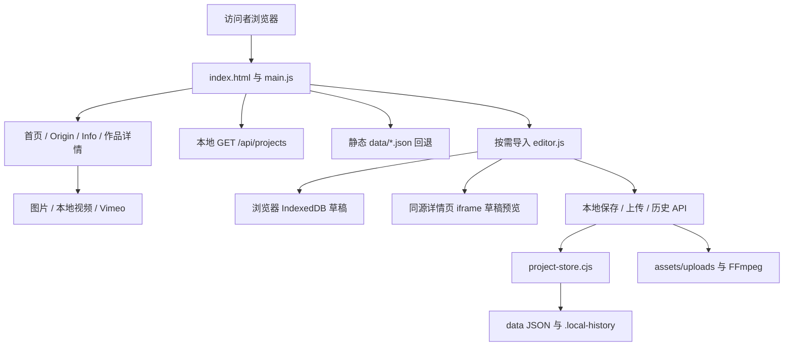

# sphr 个人作品集架构蓝图

## System Overview

本项目是展示个人视觉与 3D 制作经验的媒体作品集，另附仅在本机可写的作品编辑器。公开网站展示的是渲染图、影片和文字；当前网页入口没有实时 3D 查看器。

本文件由已安装的 `egm-bootstrap` 工作流分析生成，目标文件名采用 `EGM.md`，保留原有 README。记录日期：2026-10-27。分析范围为当前工作树的根目录、`js/`、`scripts/`，并检查 `css/`、`data/`、被引用资源与部署辅助配置。`outputs/`、工具、缓存、历史备份与测试产物不逐层生成契约，也不代表其内容被逐一审查。

| 层 | 当前技术与边界 |
| --- | --- |
| 文档与页面 | 单个 `index.html`，预置多个 main 容器；原生 DOM 操作切换页面 |
| 浏览器代码 | 原生 JavaScript ES Modules，无 React/Vue 等框架、无打包过程 |
| 样式 | 原生 CSS，变量、Grid/Flex、clamp、媒体查询；前台、后台、混排三份样式 |
| 路由 | pathname + History API；本地服务为无扩展名路径提供 HTML 回退 |
| 内容 | 内置 JS 默认值 + 部分 `data/*.json` 覆盖；首页卡片另写在 HTML/CSS 中 |
| 本地编辑 | Node 内置 http/fs/path/child_process；CommonJS 项目存储；zlib/crypto/stream 提供传输层，无数据库服务 |
| 草稿与预览 | IndexedDB、sessionStorage、同源 iframe 与 postMessage |
| 媒体 | PNG/JPEG/GIF、本地 MP4、Vimeo iframe；部分图片仍为 JSON 内 base64 |
| 字体 | 本地 Satoshi WOFF2、设备已安装的 PingFang/SF Pro 及回退字体；未使用的 Google Gothic A1 外链已移除 |
| 环境与依赖 | 根目录没有 package.json、lockfile 或统一构建命令；视频转码依赖本机 `.tools/` 中 FFmpeg；启动脚本依赖 Windows PowerShell/Node |
| 部署 | 预期公开端只部署静态文件；本地 server.js 与写入 API 不属于公开端能力 |



图中的 API、写入和 FFmpeg 仅适用于本地服务；静态部署使用 JSON 与公开媒体资源。所有资源与 API 基本使用站点根路径，不能假设直接放进任意子目录就能运行。

## Subdirectories & System Boundaries

| 边界 | 入口/契约 | 职责 |
| --- | --- | --- |
| 根目录 | [index.html](./index.html)、[server.js](./server.js) | 页面容器、资源入口、本机 HTTP 服务与静态文件回退 |
| 浏览器模块 | [js/EGM.md](./js/EGM.md) | 路由、项目渲染、交互、编辑器与排版 |
| 存储与脚本 | [scripts/EGM.md](./scripts/EGM.md) | 数据规范化、冲突/历史、HTTP 压缩/缓存/Range、启动与发布辅助工具、测试边界 |
| 样式 | [css/styles.css](./css/styles.css)、[css/editor.css](./css/editor.css)、[css/typography.css](./css/typography.css) | 全站布局与动效、后台界面、混排字体 |
| 内容 | [data/eqlz.json](./data/eqlz.json)、[data/supernova.json](./data/supernova.json)、[data/kolon.json](./data/kolon.json)、[data/auto.json](./data/auto.json)、[data/helena.json](./data/helena.json)、[data/361.json](./data/361.json) | 六个作品路由均有磁盘覆盖数据；JS 默认内容仍作为回退，首页卡片仍独立维护 |
| 媒体 | `assets/covers`、`assets/uploads`、`assets/origin`、`assets/fonts` | 可公开素材；源文件、旧文件与实际引用文件并未完全分离 |
| 部署策略 | [_headers](./_headers)、[.assetsignore](./.assetsignore)、[.gitignore](./.gitignore) | 托管缓存声明、资产排除与版本控制排除；三者不是同一种过滤器 |
| 操作说明 | [README.md](./README.md)、[EDITOR.md](./EDITOR.md)、[LOCAL_SERVER.md](./LOCAL_SERVER.md)、[GITHUB_PUSH.md](./GITHUB_PUSH.md)、[FFMPEG.md](./FFMPEG.md) | 原有说明保留；其部署目标与旧模板描述不能代替当前配置验证 |

按约定，仅生成本文件和上述两个子目录 EGM 契约；CSS、数据与素材的契约集中记录在本蓝图中。

## Interface

### 页面结构与组织

- **首页 `/`**：固定首屏视频、个人介绍、六张作品卡片、能力声明及社交页脚。卡片标题与链接来自 HTML，封面由 `.cover-1` 至 `.cover-6` 的 CSS 背景指定。
- **作品页**：共用一个模板，顺序为封面 → 品牌/项目标题 → 背景与个人参与两段文字 → Vimeo 主片 → text/image/video 区块 → 返回首页。
- **Origin**：静态文字与肖像。**Info**：简约的 Verse 外链入口，使用纯 CSS 立方体，悬停与键盘聚焦时轻微转动，支持减少动态效果偏好。
- **后台**：侧边作品列表、内容表单、媒体区块、版本与导入导出、桌面/手机真实页面预览。只在进入 `/admin` 时导入模块与后台专用 CSS。

当前没有通用组件注册系统。可复用单元是作品模板、`renderProjectBlocks()`、编辑器模板辅助函数及 `renderTypography()`；DOM 查询与页面状态仍由入口统一协调。

### 本地 HTTP 接口

| 方法与路径 | 返回/副作用 |
| --- | --- |
| `GET /api/editor` | `{writable:true, historyLimit:50}`；表示服务支持编辑，不是完整健康检查 |
| `GET /api/projects` | 读取六个白名单项目，只返回成功读取且非空的对象；读取失败被省略 |
| `GET /api/projects/:slug` | 当前项目与 ETag；缺文件为 `{}`，损坏文件报错 |
| `POST /api/projects/:slug` | JSON + `If-Match`；规范化、备份、保存并返回新 ETag |
| `GET /api/projects/:slug/history` | 可用历史版本元信息 |
| `GET /api/projects/:slug/history/:id` | 指定历史 JSON，不直接覆盖当前文件 |
| `POST /api/uploads/image` | 原始二进制 + X-File-Name；检查扩展名与 image MIME 前缀，写入后返回 URL/size |
| `POST /api/uploads/video` | 原始二进制 + X-File-Name；小 MP4 直接保留，否则尝试 FFmpeg 转码 |
| `GET/HEAD <静态路径>` | 公开读取仅限 index.html、assets/css/js/data；其他非私有、无扩展名路径回退 index.html；支持 HEAD、版本校验、文本压缩及单段 Range |

依据：[server.js](./server.js) 的 HTTP 处理器及 [http-delivery.cjs](./scripts/http-delivery.cjs)。端口优先级为 `PORT` → 命令行参数 → 4173，只绑定 `127.0.0.1`。所有响应带项目身份标记 `X-Portfolio-Server: sphr-portfolio`。

项目保存请求按 JavaScript 字符串 length 限制为 `12 * 1024 * 1024`，不是 UTF-8 字节计数；图片/视频上传按字节计数。超限当前销毁请求，不保证返回结构化 413。大输入处理属于现有行为，本轮未改写。

`PORTFOLIO_STORAGE_DIR` 可隔离可编辑 JSON、历史和 uploads。静态 `/data/` 读取仍来自源码根目录；它不是全站根路径重定向。测试服务因此需要与正式端口区分。

### 内容与资源契约

首页、Info 和 Origin 直接启动，不等待或预取项目 JSON。进入作品页时只读取该项目：本机优先单项目 API，失败后读取对应静态 JSON；正式域名直接读取对应静态 JSON，不探测本机 API。成功结果在当前页面内复用，同项目并发请求合并；请求最长 20 秒，失败显示重试入口，不展示缺少区块的默认作品。内置字段合并及旧 localStorage 兼容逻辑仍保留，但公开作品展示前必须取得有效项目数据。过期导航响应不得覆盖新路由，编辑器的新草稿优先于较早请求结果。

| 资源 | 当前加载方式 | 已观察到的事实 |
| --- | --- | --- |
| 首页首屏 | 初始 `preload=none`，source 为 data-src；`showHomePage()` 设置 src、load 并 play | 影片无 poster；源文件 7,195,131 字节，约 7.20 MB |
| 首页封面 | 六张 CSS background-image，固定 PNG，无响应式候选 | 总计 8,309,952 字节，约 8.31 MB；尺寸从 1094×856 到 1920×1920 |
| 静态模板图片 | 首页隐藏容器中的 Origin 肖像与详情默认图片同样写有 src | 没有原生 lazy；运行记录已确认首页请求了这些隐藏图片，本轮未改变其加载时机 |
| 详情图片区块 | 直接创建 img 并设置 src；比例由 CSS 控制 | 无 loading/decoding/srcset 策略；部分源为 data URI |
| 详情视频区块 | 渲染时设置全部 src，preload=metadata；静音、playsInline，默认 autoplay/loop | 没有基于可见区域的媒体观察器；metadata 不保证 autoplay 时只取元信息 |
| 主片 Vimeo | 进入作品时立即设置 iframe src；初始为 about:blank | 无点击后加载或视口加载；大部分离页路径清空该 iframe |
| 编辑器预览 | 同源详情页 iframe 接受整份草稿 | 复用前台渲染，布局一致；同时增加媒体资源与解码工作 |
| 字体 | Satoshi WOFF2 使用 swap；混排字体只用 local()；无 Google Fonts 外部 CSS | 有回退；用户未安装 Apple 字体时无法保证与维护机完全一致 |
| 3D | 在 index、js、css、server 与资产清单中未发现 Three.js、WebGL、GLTFLoader、model-viewer、GLB/GLTF 等运行入口 | 当前是 3D 作品的图像/影片展示，无实时模型加载、GPU 场景或纹理解码链路；不扩展此结论到排除的 outputs |

初次审查（2026-10-27）的磁盘统计快照（十进制 MB；不是网络实测；不包含后续 KOLON 内容与素材更新）：

| 项目 | 数量/体积 | 解读 |
| --- | --- | --- |
| `data/*.json` | 3 份，共 1,003,731 字节 | EQLZ 755,461；Supernova 247,850；KOLON 420 |
| 内嵌图片 | 3 段 data URI，共 996,961 字符 | 约 0.997 MB 随项目数据读取，不能独立做媒体缓存或懒加载；未在文档复制编码正文 |
| `assets/` | 30 文件，共 420,355,767 字节 | 包含三个明确忽略的大源素材，共 357,808,723 字节；不能把总量当作首屏下载量 |
| 其他未被这三项忽略的资产 | 约 62.55 MB | 仍包括未引用或疑似重复的旧媒体；未做自动删除，也未声称全部会发布 |

### 上传与缓存

图片上传上限 120 MiB，原样保存，不做分辨率限制、格式转换或图片压缩。视频请求上限 260 MiB；≤25 MiB 的 `.mp4` 不重编码，其他文件依次尝试 1920/1280/960/720 宽度和递增 CRF，输出 H.264/yuv420p、AAC、faststart，目标 ≤25 MiB。此体积目标不是播放兼容性、视觉质量或完整解码验证。

上传将整个请求缓存到内存，`Buffer.concat` 还会形成额外的峰值占用；压缩没有全局并发限制、时限或取消协议。单个编辑器逐个上传不等于整个服务只处理一个请求。取消使用的上传素材不会自动回收。

API 和静态项目 JSON 保持 no-store。本地传输层按 Accept-Encoding 为可压缩文本（HTML/CSS/JS/JSON/SVG）提供 Brotli/Gzip，解码内容不变，发送 Vary；API 的项目 revision ETag 原样保留，不用于 304。图片、字体、视频不重编码。

静态资源采用内容版本校验：SHA-256 ETag、`public, max-age=0, must-revalidate`，未变化时返回 304。不同压缩表示具有不同传输 ETag；文件 stat 变化会失效缓存并重算版本。这一实现没有生成指纹文件名，也没有给现有固定 URL 设置一年 immutable；因此文件原地更新不依赖手工修改前端版本号。

媒体通过文件流发送，支持单段 bytes Range、206/416、HEAD、强 ETag If-Range；无法可靠匹配的日期校验回退完整响应。多段 Range 当前忽略并返回完整 200，不生成 multipart。小文本缓冲与压缩结果按最多 32 个文件条目缓存；大媒体只缓存元信息与哈希，不整段保留在内存。

`_headers` 同步为静态资源每次校验、data no-store。本地 Node 不读取此文件；公开静态托管的压缩、ETag 与 Range 由托管平台提供，仍需单独发布与验证。本轮没有部署线上站点。

## Invariants

1. 前台必须能在没有本地 API 的静态环境下读取项目 JSON；公开部署不能依赖 Node 写入能力。
2. 编辑服务保持回环绑定、Host 校验与跨来源 POST 拒绝；不能把当前模型直接扩成互联网多人 CMS。其检查不等于已实现用户身份认证。
3. 写入 slug 固定白名单。静态公开目录限 assets/css/js/data 和 index.html；server.js、scripts、启动脚本与点路径不公开，检查包含大小写、Windows 尾随空格/点及冒号变体。前端 js 目录属于网站资源。公开部署还需要独立的产物边界，不能依赖 Node 的拒绝规则。
4. 保存需要匹配 ETag，先备份后替换；浏览器草稿、磁盘当前版本、历史版本与线上发布是四种不同状态。
5. 文案渲染保持文本安全与中英混排保真。合法排版对象的归一化不能在前后台各自演变而失配；非法类型的拒绝/默认行为不同，见浏览器模块契约。
6. `hidden` 只表示视图状态，不能当作暂停视频、取消网络、清理监听或卸载 iframe 的契约。
7. 增加作品或区块类型时需检查所有硬编码表、渲染器、编辑器与存储校验；目前没有 schemaVersion 驱动的迁移。
8. 文档中的性能风险来自源代码和资源统计；没有浏览器测量时不得标成 LCP/CLS/INP、帧率或内存峰值的实测结论。

## Side Effects

- 浏览器会读取项目数据、媒体、字体与 Vimeo；编辑器写 IndexedDB/sessionStorage，前台还兼容旧 localStorage。
- 路由与动画更新 history、DOM、全局事件、滚动与 CSS 状态；多个页面容器常驻同一文档。
- 本地服务读写 JSON、历史与 uploads，可能启动 FFmpeg；存储失败语义与持久性限制见脚本契约。
- 启动器写日志并创建进程；推送器会暂存、提交并推送全部未忽略改动。当前传输优化使用本地监听与隔离测试，没有对真实作品测试保存/上传，没有执行推送。

## 主要问题与优先级

优先级指后续处理顺序，不表示本轮已修复。

| 优先级 | 问题与证据 | 影响与下一步 |
| --- | --- | --- |
| P1 | 内容存在多个独立来源；初次审查发现 KOLON 路由误配 Helena Rubinstein/Replasty。2026-10-29 已修正 `main.js` 与 `data/kolon.json` 的 KOLON 内容，并添加本地作品页第一版 | 当前误配已修正；多处内容同步仍依赖人工维护，可进一步统一目录结构 |
| P1 | 所有路由初始化先等待全量项目数据；约 1 MB JSON 基本由三张内嵌图片组成 | 与当前页面无关的内容成为启动前置依赖；优先媒体外置与按作品读取 |
| P1 | 首页视频与作品/后台预览没有统一离页暂停或卸载；图片/Vimeo/区块视频缺少一致的分级加载 | 潜在额外流量、解码与耗电；需路由生命周期协议与网络/播放验证 |
| P1 | `body` 默认透明，显示依赖入口注册 load 回调；未设置无脚本/入口失败兜底 | 入口异常或禁用 JS 时可能整站不可读；决定渐进增强或预渲染底线 |
| P2 | 6 张封面约 8.31 MB，首屏影片约 7.20 MB；无响应式图片，上传允许大图原样落盘 | 建立封面/详情/源素材分层和资源预算；不能只靠最终视频 25 MiB 限制 |
| P2 | 单入口承担路由、内容、渲染和动画；样式中留有旧 `.admin-*` 规则，新编辑器主要使用 `.ed-*` | 修改耦合与样式回归风险；先划职责和状态边界，无需据此立即迁移框架 |
| P2 | reduced-motion 仅覆盖 CSS；700 ms JS 滚动与视频自动播放另无策略，路由缺少统一焦点恢复 | 可访问性与动效偏好不完整；补充明确交互契约后再实现 |
| P2 | 未知 URL 返回首页；直接访问依赖托管 HTML 回退，路径写死 `/` | 明确 404、基路径与搜索/分享预览策略；当前详情没有独立预渲染元数据 |
| P2 | 上传仍整包缓冲，转码无全局并发预算 | 并行上传可能占用较多内存；静态媒体流与 Range 已实现，但不代表上传处理也已流式化 |
| P2 | 没有统一依赖/运行版本清单；README 提及 GitHub Pages，GITHUB_PUSH 提及 Cloudflare 与自定义域名；缓存、回退和产物规则未形成唯一部署契约 | 新环境与发布验收不易复现；明确实际托管目标，补足发布产物和验证标准 |
| P2 | 校验规则多处重复，读取 JSON 不经过保存时的完整规范化；聚合读取失败会静默省略项目 | 错误数据可能变成旧默认内容，掩盖故障；定义共享 schema、迁移与显式错误状态 |
| P3 | 历史只备份 JSON；导出不含媒体；上传缺少引用追踪与清理 | 随项目增长会累积素材，旧版本也可能断引用；决定完整备份与安全回收策略 |

现有优点应保留：后台按需导入、复用真实页面预览、图片 alt/caption 支持、同源消息校验、基于 ETag 的冲突拒绝、先备份再替换，以及已有的存储/排版测试。

## 值得进一步使用 EGM 审查的技术决策

| 顺序 | 待决策问题 | 审查应回答与验收证据 |
| --- | --- | --- |
| 1 | 项目内容是否采用单一目录与有版本的 schema？ | 首页与详情各字段归谁维护；slug/封面/视频/个人贡献能否统一；缺失内容如何报告；用 KOLON 修正与新增项目演练验证 |
| 2 | 媒体采用什么加载预算和生命周期？ | 首屏必须加载什么，何时加载 Vimeo/详情视频，离页与后台标签如何暂停，预览如何停用；提供窄屏网络瀑布、播放状态与内存记录 |
| 3 | 是否保留当前轻量单页结构，或做小型静态预渲染？ | 依据作品数量、内容维护成本、直接访问/分享/无 JS 要求比较；不能仅以“专业”为理由增加框架和依赖 |
| 4 | 本地编辑到静态发布的正式契约是什么？ | 明确托管根路径、HTML 回退、缓存失效、产物白名单、API 不存在时的行为及发布后验收；确认源码/outputs 是否进入部署 |
| 5 | 本地 JSON 保存的失败、备份与多人边界如何定义？ | 替换后失败是否重读、跨进程写入是否允许、历史与媒体如何一起恢复；用故障注入与恢复演练验证，决定是否需要更强事务存储 |
| 6 | 混排与响应式排版需要什么跨设备保证？ | 字体授权/本地回退、120 px 等极端字号的窄屏表现、字重映射和旧样式迁移；用真实设备与中英混排样例验收 |

可优先把第 1、2、4 项写成明确决策文档，再用 EGM Review 检查可理解性、设计取舍与可实施性；完整 Review 尚未执行。契约已通过 EGM Drift Report 流程核对，初查差异与传输优化后的复核分别保留在报告中。

## System Verification

### 初始架构审查

- 三个只读 scout 分别检查根目录、浏览器模块和生产脚本，按每文件最多展示 300 行及每目录约 50 KB 的预算选读；未覆盖的长文件尾部由主分析补读。根目录 scout 曾为计数内部载入完整 server.js，实际展示与分析限于前 300 行，此细节不影响主分析另行核对完整文件。子目录契约先编写，再汇总本蓝图。
- 主分析核对完整 server.js、main.js、编辑器关键状态/保存/导入/上传/事件链，检查 CSS、静态 JSON、资产大小及图片尺寸。未逐帧解码影片或逐项审查排除目录。
- 初始存储/排版测试 10/10 通过。初次静态审查时 4173 未响应；随后恢复服务并完成运行测量，结果保留在 [初始性能报告](./2026-10-27_PERFORMANCE_REPORT.md)。

### 传输优化后的验证

- 新增 HTTP 传输模块，不改变 HTML、CSS、公开端 JS、真实项目 JSON、图片和视频内容。后台 editor.js 仅补充样式加载就绪等待，以避免预览初次测量宽度的竞态；未改排版值或操作方式。SHA-256 与压缩解码比对用于核对内容保真。
- Node v24.15.0 下相关测试 15/15 通过，包含 Brotli/Gzip、q=0、304、同 URL 更新、HEAD、Range 边界、If-Range、API revision 保持，以及隔离服务的保存/历史/上传/预览兼容性。
- 真实浏览器检查首页播放、作品与 Origin 导航、手机菜单及 Escape。四个桌面页面按原条件复测，完整结果保留在 `.editor-test/transport-optimization/`；不能仅凭单次分数波动声称整体提速比例。

```powershell
node --test scripts/http-delivery.test.cjs scripts/editor-store.test.cjs scripts/typography.test.mjs
```

### 未覆盖与验收限制

- 手机 Lighthouse 绘制指标在初测与复核中不稳定，未得出可靠手机评分；手机视口可见性检查不是实体设备性能验证。
- 未运行既有固定 4174 的 fixture/smoke 脚本；本轮使用临时目录与临时端口的应用集成测试。未对真实作品执行测试保存或上传。
- 未联网确认公开部署、CDN、真实流量、电池消耗、持续滚动帧率或 GPU 占用。
- 未安装项目依赖、修改视觉/动画/作品内容或提交 Git。原有未提交改动保留。

初始审查仅新增三个 EGM 契约。后续传输优化更新了 server.js、_headers、新传输模块/测试、后台样式就绪顺序及相关文档；HTML、CSS、公开端 JS 和项目内容继续保持原样。实施与复测见 [传输优化记录](./2026-10-27_TRANSPORT_OPTIMIZATION.md)，一致性复核记录追加在 [Drift Report](./2026-10-27_DRIFT_REPORT.md)。
